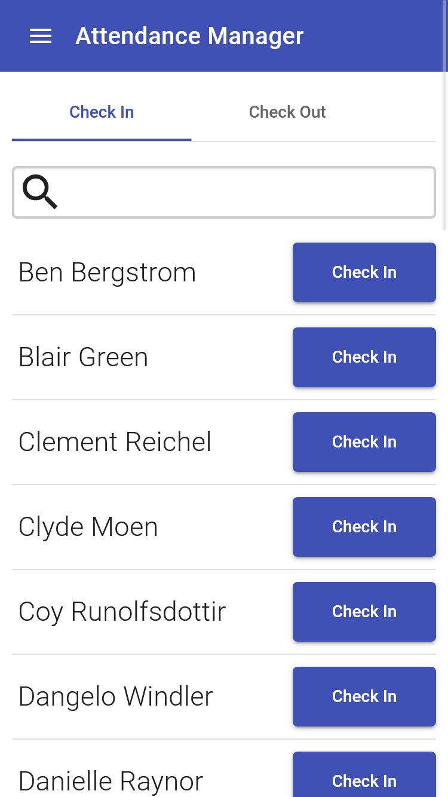
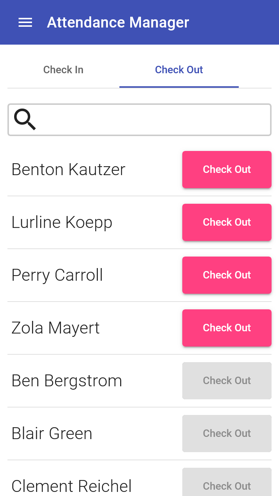
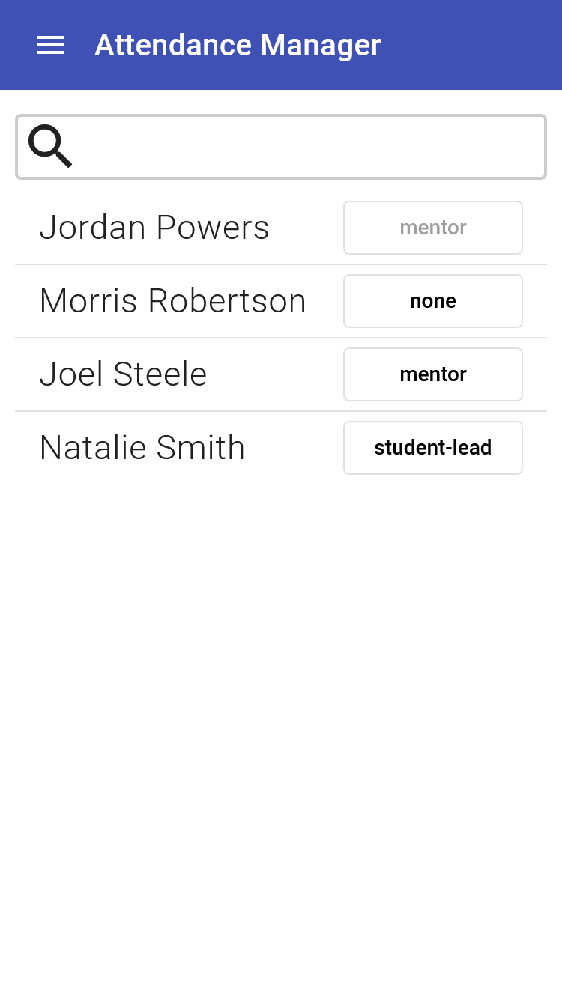
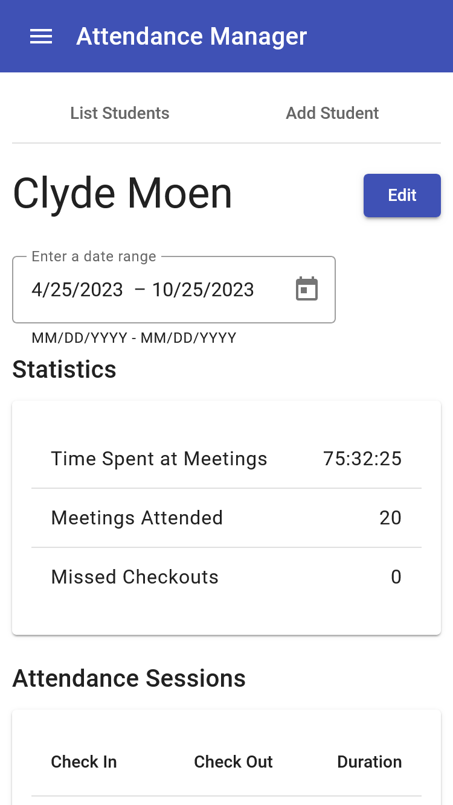
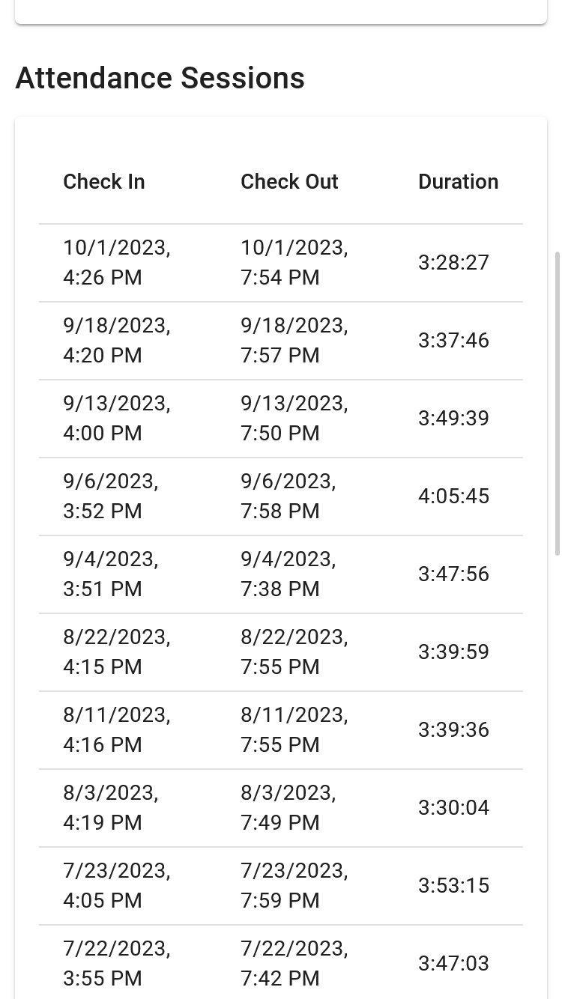
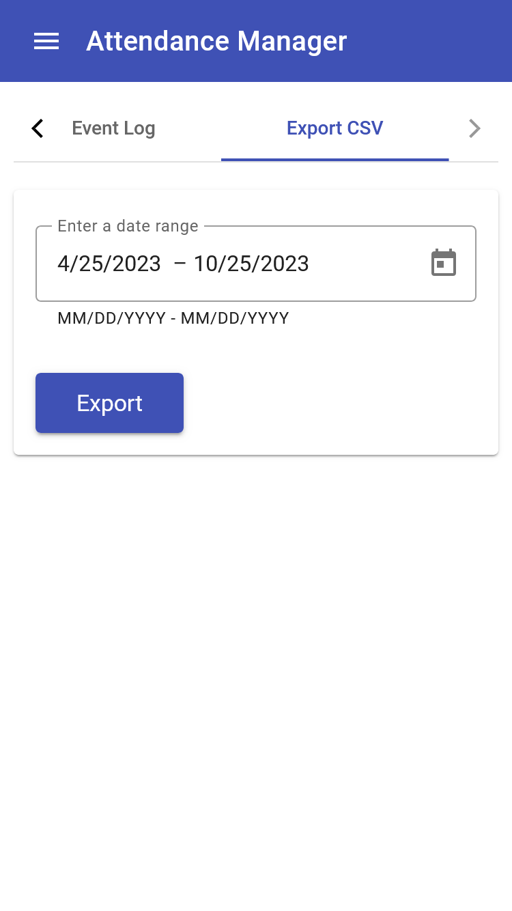
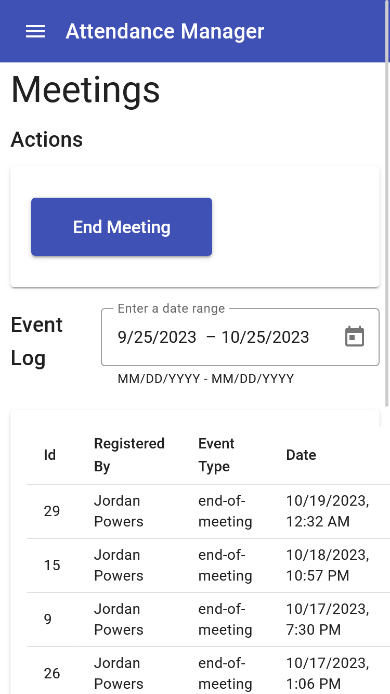
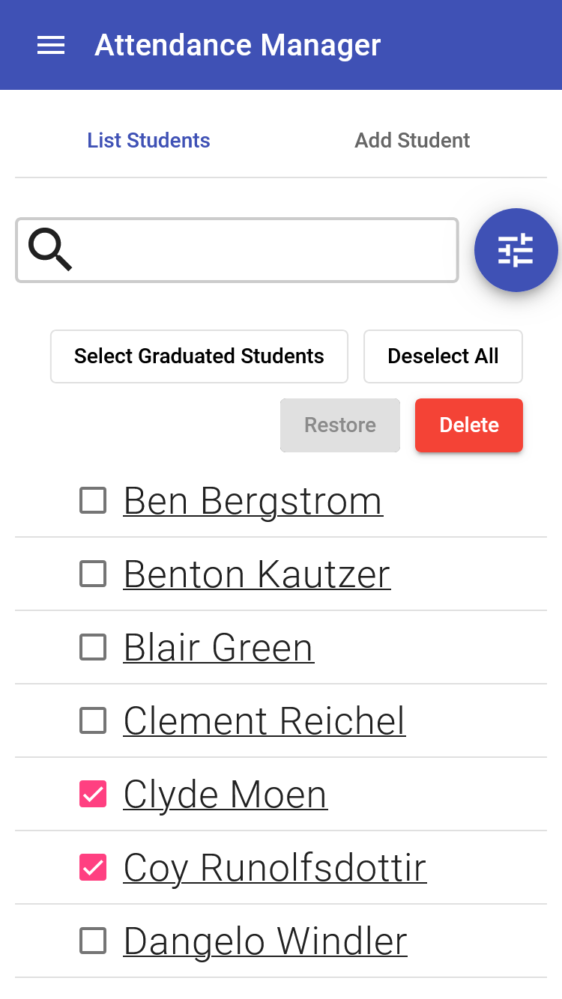

# Attendance Manager
Tracks student attendance at FRC robotics team meetings.

## Features

### Track Student Attendance
Check students in or out as they arrive at or depart from team meetings.

### Different User Roles
Users can be assigned one of three roles: none, student-lead, or mentor.
Users with no role cannot access the application, student-leads have only
limited access, and mentors have full access.

### Student Attendance Details
Various statistics concerning every student's attendance is tracked: total time spent
at meetings, number of meetings attended, number of missed checkouts, and a list of
attendance sessions.

### Export to CSV
Every report can be exported to csv for external processing, using the "Export CSV" button above the report's table.

### Track Meetings
The end of team meetings can be registered manually or automatically, which will mark all students
as checked out.

### Bulk Student Actions
Students can be deleted or un-deleted in bulk. Also, every student's expected
graduation year can be tracked, and graduated students can be automatically
removed from the application.

# Development

- [docs/development.md](docs/development.md): setting up a development environment and running the tests
- [docs/architecture.md](docs/architecture.md): an overview of how the application is put together
