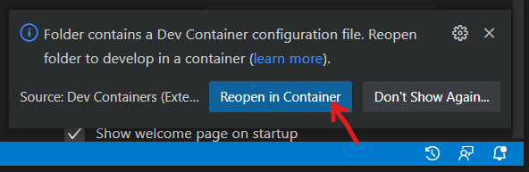
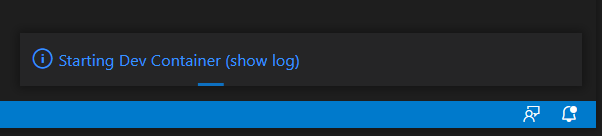

# Setting up a development environment

## Prerequisites
- [Docker](https://docs.docker.com/get-docker/)
- [Visual Studio Code](https://code.visualstudio.com/), with the [Remote Development Extension Pack](https://marketplace.visualstudio.com/items?itemName=ms-vscode-remote.vscode-remote-extensionpack).

## Steps
1. Clone the repo and cd into the clone.
```
git clone git@github.com:momentumfrc/attendance-manager.git && cd attendance-manager
```
2. Open the attendance-api folder in vscode.
```
code attendance-api
```
3. When prompted, choose to reopen in container.


4. Wait for vscode to finish setting up the container.


5. You may be prompted to install recommended extensions. You should do so.

6. In the vscode console, run the following to set up the api.
```bash
php artisan key:generate
php artisan migrate --seed
php artisan storage:link
```

7. Open the attendance-web folder in a separate vscode window.
```
code attendance-web
```

8. Again, when prompted, choose to reopen in container.

9. Open a web browser and navigate to <http://localhost/>. Note: it might take a while for the
application to start up. If the page fails to load, try again in a few minutes.

# Running the tests

CI runs both suites on every push and pull request to master (see `.github/workflows/tests.yml`).

## API tests (PHPUnit)

The API tests run against a separate `attendance_api_testing` database, so they never touch
your development data. The mariadb container creates this database automatically the first
time its volume is created.

From the attendance-api vscode window's terminal (inside the dev container):
```bash
php artisan test
```

Or, from the repo root on your host, using docker compose:
```bash
docker compose exec laravel.test php artisan test
```

To run a subset of the tests, use `--filter` with a test class or method name:
```bash
php artisan test --filter=AttendanceEventControllerTest
```

## Web tests (Karma/Jasmine)

From the attendance-web vscode window's terminal (inside the dev container):
```bash
npm test
```
This starts Karma in watch mode and opens Chrome. To run once headless, as CI does:
```bash
npm test -- --no-watch --no-progress --browsers=ChromeHeadless
```
Note that the web dev container doesn't install Chrome, so these commands need a Chrome
installation available (set `CHROME_BIN` if it isn't on your path). Running them on your
host, from the `attendance-web` directory after `npm install`, is the simplest option.
